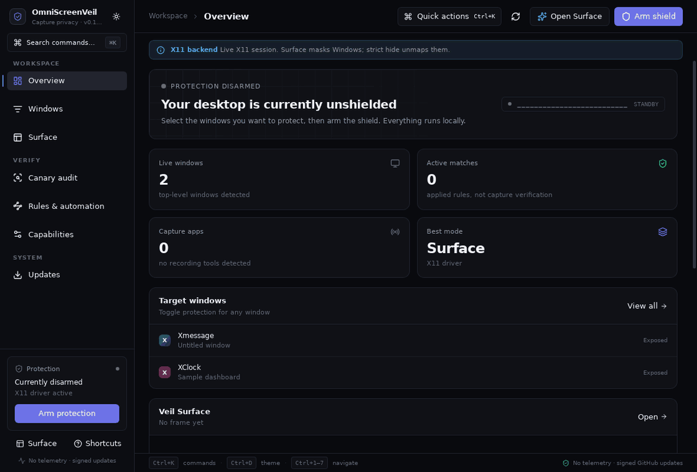

# OmniScreenVeil

Selective screen-capture privacy for Windows, macOS and Linux.

[Project website and browser demo](https://j1seki.github.io/omniscreenveil/) · [Downloads and prereleases](https://github.com/j1seki/omniscreenveil/releases)



Pick which windows you want to keep out of a share, then open and share the
dedicated **OmniScreenVeil Surface** window. The original windows stay usable
on your desktop. Sharing the whole desktop instead bypasses Surface rules.

OmniScreenVeil is **not** a window hider, a fake-camera filter, or a screenshot
blocker. It is honest about where each technique works:

| Mode | What it does | Where it works |
|---|---|---|
| **Exclusion** | Asks the OS to omit the window from compatible capture paths while it stays usable locally. Verify your actual capture app. | **Windows only, experimental** (display affinity + a small helper loaded into the app you selected). |
| **Veil Surface** | Share a window we render: a desktop copy with selected windows filtered out or masked. | **All platforms.** On Wayland it needs a geometry provider and is marked partial. |
| **Strict hide** | Hide the window on your own screen for the session, then restore it. | **All platforms** with the right permission. |

Anything not listed above is not claimed. macOS, X11 and Wayland have **no**
public per-window capture exclusion, and OmniScreenVeil does not use private
APIs, SIP changes, a patched X server or a root kernel module to pretend
otherwise. See [`docs/support-matrix.md`](docs/support-matrix.md) for the full
matrix and [`docs/threat-model.md`](docs/threat-model.md) for what stays out of
scope.

## Status

The desktop app is a prerelease. Linux/X11 and sway have live capture tests.

- The shared core, canary verifier, Veil Surface compositor and CLI are
  implemented and tested on Linux.
- The Linux/X11 backend is validated end to end against a real X server
  (`Xvfb`) with pixel assertions.
- The Tauri desktop app builds and runs; it is verified under Xvfb in this
  repository. It ships a signed updater with `stable` and `beta` channels,
  automatic update checks and an explicit install/restart step.
- The Windows and macOS backends compile behind their target gates and have
  Phase 0 probes, but still need runtime validation on real Windows and macOS
  machines. Run the probes in [`docs/phase-0-spikes.md`](docs/phase-0-spikes.md)
  and report what you see.
- The Wayland backend uses `grim` for capture and compositor IPC for geometry
  and strict hide. The sway paths have been tested against a headless compositor.
  Hyprland still needs runtime validation. GNOME Shell and KDE Plasma show
  a labelled simulation.

Verification is captured in [`docs/verification.md`](docs/verification.md).

## Install on macOS

The release DMG targets **Apple silicon with macOS 14 or later**. Open the DMG,
drag OmniScreenVeil into Applications, then open the app from Applications.
Apple-signed, notarized releases do not require **Open Anyway**. If macOS says
an older download should be moved to the Trash, replace it with a current
notarized release rather than overriding the warning.

**Temporary workaround for a trusted test build:** If you built the app yourself
or verified where the build came from, copy it into Applications, then run this
from the repository in Terminal:

```sh
bash tools/open-macos-test-build.sh
```

You can also pass the installed `.app` path as an argument. The script checks
the bundle and its code signature, asks before removing quarantine from that
copy, then opens it. It doesn't use `sudo` or change system-wide settings. This
isn't a fix for a damaged build or a malware warning; if verification fails or
macOS still blocks it, download a fresh notarized build.

In the app, use **Request Screen Recording** for Veil Surface and **Request
Accessibility** only if you use strict hide. macOS still requires your consent.
The permission panel can open the exact settings page if the prompt doesn't
appear. If macOS asks you to quit and reopen after granting Screen Recording,
do that before using the Surface.

## Layout

```
crates/
  veil-core          domain types, rules, reconciliation, capability matrix
  veil-surface       frame buffer + Veil Surface compositor
  veil-canary        8x8 canary token renderer and detector
  veil-protect       backend trait, engine, simulated backend
  veil-verify        baseline -> arm -> capture verification harness
  veil-protect-linux X11 backend (inventory, composite capture, strict hide)
  veil-protect-wayland Wayland backend for sway/Hyprland (grim + compositor IPC)
  veil-protect-win   Windows backend (injection + display affinity)
  veil-hook-win      helper DLL loaded into a selected process
  veil-protect-macos macOS backend + C ABI to the Swift helpers
apps/
  cli                the `veil` command-line agent
  desktop            Tauri 2 + React desktop application
platform/macos       Swift package: CGWindowList, Accessibility, ScreenCaptureKit
docs/                support matrix, threat model, verification, ADRs
research/            product research and constraints
tools/               release helpers (updater manifest generator)
```

The CLI and the desktop app consume the same crates. No protection policy lives
in the UI.

## Build and run

Use stable Rust. The locked dependencies require Rust 1.85+ for the workspace
and 1.90+ for the desktop app. Desktop builds also need Node 20+, pnpm and the
[Tauri 2 system dependencies](https://v2.tauri.app/start/prerequisites/).
On Debian/Ubuntu the webview packages are `libwebkit2gtk-4.1-dev` and
`libayatana-appindicator3-dev`.

```sh
# core tests and self-test (no display required)
cargo test --workspace
cargo run -p veil-cli -- selftest

# honest capability matrix
cargo run -p veil-cli -- capabilities
cargo run -p veil-cli -- capabilities --platform wayland

# live X11 inventory, surface preview and strict hide
cargo run -p veil-cli -- list
cargo run -p veil-cli -- surface --live --protect 0x1a --out veil.ppm
cargo run -p veil-cli -- protect 0x1a --mode strict-hide
cargo run -p veil-cli -- release 0x1a
```

Desktop app:

X11 needs a display. For sway or Hyprland, install `grim` and the compositor's
IPC tool (`swaymsg` or `hyprctl`). Missing capture tools produce a capture
error in the app. Unsupported Wayland compositors show a labelled simulation.

```sh
cd apps/desktop
pnpm install
pnpm tauri dev        # development, live backend
pnpm build            # typecheck + frontend bundle
pnpm tauri build      # native bundle
```

macOS Phase 0 helpers:

```sh
cd platform/macos
swift build -c release
.build/release/veilmac-spike permission
.build/release/veilmac-spike list
swift test
```

For a local Apple silicon test bundle (no notarization or updater artifact),
run this from the repository root on a Mac with Xcode installed:

```sh
pnpm --dir apps/desktop install --frozen-lockfile
pnpm --dir apps/desktop tauri build --bundles app --config '{"bundle":{"createUpdaterArtifacts":false,"macOS":{"signingIdentity":"-"}}}'
open apps/desktop/src-tauri/target/release/bundle/macos/OmniScreenVeil.app
```

### Updates and release channels

The desktop app uses Tauri's signed updater.

Merging a pull request into `main` starts the signed release workflow for that
merge commit. The version in `tauri.conf.json` selects the channel. If its
version is already used, the workflow increments the patch for stable or the
prerelease identifier for beta. An automatic tag records the version used by
all build jobs and lets a retry reuse it. Pushing a version tag or dispatching
the workflow for an existing tag also works.

Both channels use GitHub Releases.

- **stable** — tags without a pre-release suffix (`v0.2.0`). The workflow
  publishes a normal GitHub release with `latest.json`; the app reads
  `releases/latest/download/latest.json`.
- **beta** — SemVer pre-release tags (`v0.2.0-rc.1`, `v0.2.0-beta.2`). The
  workflow marks them as GitHub pre-releases and refreshes `latest.json` on the
  rolling `updater-beta` release, which is what the beta endpoint reads.

`releases/latest` deliberately excludes pre-releases, so a beta can never be
served to stable users. Switching from beta to stable does not downgrade an
installed beta; the next newer stable release replaces it.

The updater verifies bundles before installing them. The updater public key is
checked into `tauri.conf.json`; the private key and its password must be stored
as the `TAURI_SIGNING_PRIVATE_KEY` and `TAURI_SIGNING_PRIVATE_KEY_PASSWORD`
repository secrets. A local release build needs the same two variables:

```sh
export TAURI_SIGNING_PRIVATE_KEY="$(cat "$HOME/.tauri/omniscreenveil.key")"
export TAURI_SIGNING_PRIVATE_KEY_PASSWORD="$(cat "$HOME/.tauri/omniscreenveil.key.password")"
cd apps/desktop/src-tauri
pnpm tauri build
```

Back up the private key and password. Losing them means existing installs can
never receive another update; leaking the private key lets someone sign a
malicious update. The release workflow also refuses to publish when a tag does
not match the version in `tauri.conf.json`, and derives the channel from SemVer,
so a workflow dispatch from a branch cannot mark an RC as stable "latest".

### macOS release signing

The updater signature does not satisfy macOS Gatekeeper. For both stable and
beta releases, configure these GitHub Actions repository secrets before
building a release:

| Secret | Value |
|---|---|
| `APPLE_CERTIFICATE` | Base64-encoded `.p12` exported from Keychain, including the Developer ID Application certificate and its private key |
| `APPLE_CERTIFICATE_PASSWORD` | Password for the `.p12` export |
| `APPLE_SIGNING_IDENTITY` | Full identity, `Developer ID Application: Name (TEAMID)` |
| `APPLE_ID` | Apple Account email for notarization |
| `APPLE_PASSWORD` | App-specific password for that account, not the account password |
| `APPLE_TEAM_ID` | Developer team ID for that account |

Tauri signs and notarizes the app before creating the DMG and updater archive.
[`tools/verify-macos-release.sh`](tools/verify-macos-release.sh) notarizes and
staples the DMG, then checks it with Gatekeeper. It also checks the app extracted
from the updater archive. The workflow fails before upload if these checks fail.
For a release smoke test, download the published DMG through a browser on a
clean Mac, install it into Applications, and launch normally. Deny each feature
permission once to confirm the app still opens; then use the panel to grant it
and check that Surface capture and strict hide work independently.

## How protection works

### Verify the output you intend to share

Use **Capture test** to compare live Surface frames with protection off and on.
The active status in the dashboard indicates that the backend applied the rule.
Check the receiver's view in your actual sharing app before showing sensitive
content. The automated canary verifier compares pixels and reports
`Inconclusive` when the baseline contains no canary.

### Windows

For the portable ZIP, quit OmniScreenVeil from the tray and run
`Uninstall-OmniScreenVeil.cmd` from the extracted folder. It removes the executable
and helper DLL, but keeps `app-data`. Windows can keep the helper DLL locked while
another app that used Exclude is still running. Close that app, or restart Windows
and run the uninstaller before reopening it. The script does not force-close apps.

`Exclusion` injects `veil_hook_win.dll` into the process that owns the selected
window. The main application marks windows with the
`OmniScreenVeil.Protected` property; the helper applies
`SetWindowDisplayAffinity(WDA_EXCLUDEFROMCAPTURE)` from inside the owning
process, which is the only way Windows accepts that call for a foreign window.
`StrictHide` uses `ShowWindow`. The hook is loaded only into the process the
user selected, and is unloaded best-effort on release.

### macOS

There is no public API for one application to remove another application's
window from another capture client's stream, so system-wide **Exclusion** is
reported unsupported. The Veil Surface uses ScreenCaptureKit to filter out
selected windows and OmniScreenVeil's own windows from each selected display
before any pixels reach the preview. It does not change what Zoom,
OBS, or a full-desktop share sees when they capture your desktop directly.
Strict hide uses the Accessibility `AXMinimized` attribute with your consent.

To test on a Mac: grant Screen Recording, place a harmless window on the main
display, and select **Surface** for it in Windows. Render a preview: the target
should be gone without moving or minimizing it locally. Share only the Veil
Surface in your actual capture app and check the receiver view. Move and resize
the sample window, open another window of the same app, then disarm and confirm
it comes back in the Surface.

### Linux

On X11 a normal client can enumerate foreign windows and read geometry, so the
Veil Surface works. With a compositing manager (`xcompmgr`, `picom`, KWin,
Mutter, ...) the backend composites foreign window pixmaps via XComposite
(`NameWindowPixmap`), which captures obscured windows and drops the app's own
control and Surface windows before the audience ever sees them. Without a
compositor it falls back to a root capture and masks its own windows. Strict
hide unmaps the window and restores it. Starting the app again after a crash
restores windows it marked before hiding, even if the window manager removed
them from the inventory. Older builds can leave unmarked windows that need
manual restoration with `veil release <window-id>`.

The desktop app provides an **Open Surface** action (and tray entry). Share
that dedicated window rather than your desktop. Hover along its top edge to
select all displays or one display, refresh, or close it. The dashboard’s
**Surface → Surface playback** controls offer
periodic snapshots, up to five reduced-size frames per second (capture speed
permitting), and manual refresh. On Windows, **Native stream** uses a persistent
DXGI Desktop Duplication session for one selected display (up to 960 px, with a
12 fps playback cap). Use snapshots for all displays together, rotated displays,
or if your graphics adapter does not support duplication. Surface capture pauses
when its window is minimized; the dashboard preview refreshes on Overview and
Surface. On Windows, the dashboard has the same mode controls as other apps.
An unprotected dashboard can appear in the separate share window, but never in
its own embedded preview. If you choose Strict Hide for the dashboard, release
protection from the tray menu to bring it back. The pop-out itself stays masked.

To demonstrate or verify, stop any active share, choose a harmless test app,
and set a Surface rule. Use **Capture test** to take real before/after frames
with the main **Arm / Disarm** control. Disarming keeps saved rules and pauses
automation for the current session; you can re-arm without rebuilding rules.
The comparison tests this app's output only, not another client's capture path.

On backends that mask by window position, the desktop app compares protected
window bounds before and after capture. If they differ, the Surface drops the
frame and retries. These samples are not atomic: a window that moves away and
back between samples can still be missed. If the Surface keeps retrying,
render a preview in the main window to see the capture error privately.

On Wayland the compositor owns geometry and capture. The sway/Hyprland backend
combines two public surfaces: `grim` (wlr-screencopy) for frames and the
compositor's own IPC (`swaymsg -t get_tree`, `hyprctl clients -j`) for window
rectangles and strict hide. Protected windows are masked in the composited
Surface. Strict hide moves them to a private workspace and returns them to
the original workspace on release within the same session. After a restart or
when using the CLI, restore moves them to the current workspace. GNOME Shell
and KDE Plasma show a labelled simulation. `Exclusion` is unavailable on Wayland.

## Repository conventions

- GPL-3.0-or-later. See [`LICENSE`](LICENSE) and [`NOTICE.md`](NOTICE.md).
- No telemetry. The only network access is the signed update check against
  GitHub Releases when automatic checks are enabled or you press Check now.
- Format with `cargo fmt`, lint with `cargo clippy -- -D warnings`.
- Regenerate the dark-mode GIF with `bash tools/record-dark-demo.sh` after a
  Linux desktop build. It uses only an isolated Xvfb session and demo windows.
- Every `Native` capability in the matrix must have a capture test that proves
  it. If a test cannot run on a machine, it reports a skip, not a pass.
