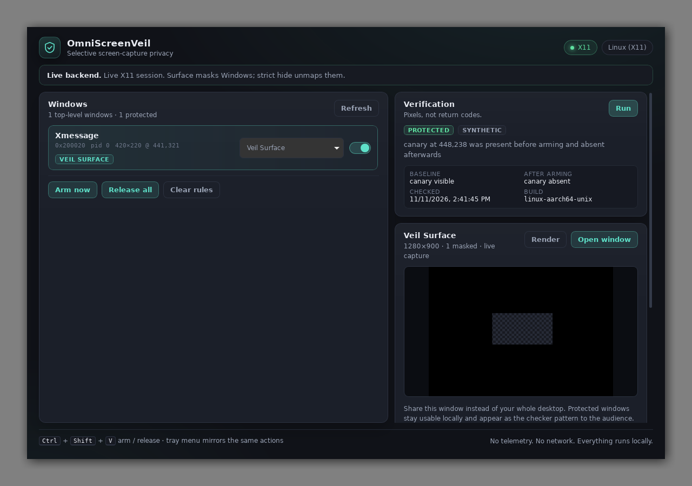
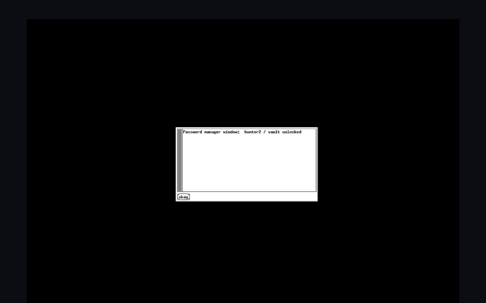

# Verification

OmniScreenVeil does not accept "the API returned success" as proof. Every
protection claim is checked against pixels captured through the path an audience
would use.

## The harness

`veil-verify` implements the only ordering that proves anything:

1. Composite an **8×8 canary token** into the region that will be protected.
   Tokens are deterministic per run and colour-coded, so a single matching tile
   is not enough; the detector requires a spatial arrangement.
2. **Capture the baseline** through the target capture path.
3. **Arm** protection (apply exclusion, start the Surface plan, or hide the
   window).
4. **Capture again** and search for the canary.

Outcomes:

| Baseline | After arming | Reported |
|---|---|---|
| canary present | canary absent | `Protected` |
| canary present | canary present | `Visible` |
| canary absent | anything | `Inconclusive` — we could not observe the content, so we cannot claim anything |

The verifier records the capture path, timestamp, OS build and a human-readable
detail string with every run. The UI shows the baseline and post-arm detections
side by side.

## What can be run on a normal machine

### Linux / X11 (validated here)

```sh
cargo test -p veil-protect-linux --test x11_end_to_end
```

`crates/veil-protect-linux/tests/x11_end_to_end.rs` starts its own `Xvfb`
(800×600), draws a real canary window, captures the root window, and asserts:

1. the canary is detectable in the raw root capture,
2. the Veil Surface plan removes it from the composited frame,
3. `XUnmapWindow` strict hide removes it from a fresh root capture,
4. `XMapWindow` restores it.

The test reports a skip if `Xvfb` is unavailable. It passed in this repository
in ~0.5 s. See the evidence section below.

### Headless core self-test

```sh
cargo run -p veil-cli -- selftest
```

Runs 12 checks over rules, reconciliation, downgrade behaviour, canary
detection, pruning and the simulated baseline→arm→capture flow. No display or
permissions required.

### Desktop app

The Tauri app was launched under Xvfb with a live X11 backend and an `xmessage`
window. The inventory showed only that foreign window (the app's own windows are
filtered by PID), the Veil Surface preview masked the app's own rectangle to
avoid recursion, and the capability matrix rendered `Exclusion → unsupported`
for X11.

## What must be run on real Windows and macOS

These are deliberately not claimed from a Linux VM.

### Windows

1. Build `veil_hook_win.dll` and the app with the MSVC toolchain.
2. Start a canary host (any window drawing a known token) and a capture client
   that uses Windows Graphics Capture (OBS "Windows 10" source, or the bundled
   verifier).
3. Arm `Exclusion`, capture, and confirm the canary disappears while the window
   remains visible and interactive.
4. Release and confirm the canary returns.
5. Repeat under a hardware-accelerated app; if the capture path ignores display
   affinity, the verifier must report `Visible`.

### macOS

```sh
cd platform/macos && swift build -c release && swift test
.build/release/veilmac-spike permission
.build/release/veilmac-spike list
.build/release/veilmac-spike capture 1
```

1. Grant Accessibility and Screen Recording.
2. Strict hide a window, run the ScreenCaptureKit capture, confirm the canary is
   absent, then show it again.
3. Confirm `Exclusion` is reported unsupported in the UI and CLI. It must never
   silently "succeed".

### Wayland

The sway/Hyprland backend is implemented in `crates/veil-protect-wayland`.
It has no live compositor to test against in this repository's headless VM, so
runtime validation is explicitly listed as unverified. Unit tests cover the
parts that can be checked deterministically:

```sh
cargo test -p veil-protect-wayland
```

- sway tree → window inventory (absolute geometry, workspace, own-process
  filtering),
- Hyprland client JSON → inventory (address round-trip, workspace, hidden
  state),
- PPM parser used for `grim` frames, including pixel bytes that look like
  whitespace and truncated payloads.

On a real sway or Hyprland session:

```sh
cargo run -p veil-cli -- list
cargo run -p veil-cli -- surface --live --protect <window-id> --out veil.ppm
cargo run -p veil-cli -- protect <window-id> --mode strict-hide
cargo run -p veil-cli -- release <window-id>
```

Confirm the Surface masks protected rectangles and strict hide removes the
window from `grim` output. GNOME/KDE must report partial, not protected.

## Evidence from this repository

Environment: headless aarch64 Debian 13 VM, Rust workspace, `Xvfb` available.

`cargo test --workspace` (2026-11-11):

```
veil-canary           10 passed
veil-cli               3 passed
veil-core             27 passed
veil-protect         9 passed
veil-protect-linux     1 passed  (x11_end_to_end, real Xvfb pixels)
veil-protect-wayland   9 passed  (sway/Hyprland JSON + PPM parsing)
veil-protect-win       3 passed  (compile-gated unit checks)
veil-surface          11 passed
veil-verify            5 passed
all other targets      0 failed
```

`veil selftest` → 12/12 PASS, exit code 0.

Frontend: `pnpm build` (tsc + Vite) succeeds. Tauri Rust: `cargo build` succeeds
against `libwebkit2gtk-4.1`.

Visual evidence: the screenshots in `docs/images/` were captured from the
running app under Xvfb + `xcompmgr` with a live X11 backend. They are not
mockups. The preview and the dedicated `OmniScreenVeil Surface` window are
real XComposite window captures composited by `veil-surface`: our own windows
are excluded from the composite, the foreign `xmessage` window is visible when
disarmed, and its rectangle is replaced with the checker veil once armed.







## Reproducing the headless UI check

```sh
# terminal 1
cd apps/desktop && pnpm dev

# terminal 2
Xvfb :77 -screen 0 1280x900x24 -nolisten tcp &
DISPLAY=:77 xmessage -geometry 420x220+440+320 "canary window" &
cd apps/desktop/src-tauri
DISPLAY=:77 dbus-run-session -- env DISPLAY=:77 \
  WEBKIT_DISABLE_COMPOSITING_MODE=1 WEBKIT_DISABLE_DMABUF_RENDERER=1 \
  ./target/debug/omniscreenveil-desktop
# terminal 3
DISPLAY=:77 import -window root docs/images/app-x11.png
```

`WEBKIT_DISABLE_COMPOSITING_MODE` is needed on headless WebKitGTK without a
GPU; it is not required on a normal desktop session.

## Honesty rules for contributors

- Never report `Protected` without a baseline that saw the canary.
- Never add a platform row to the matrix without a capture test.
- If a test cannot run (permission, hardware, OS version), report skip and keep
  the matrix entry honest. Do not turn a skip into a pass.
- Preserve the `Inconclusive` outcome. It is the product's most important
  feature.
