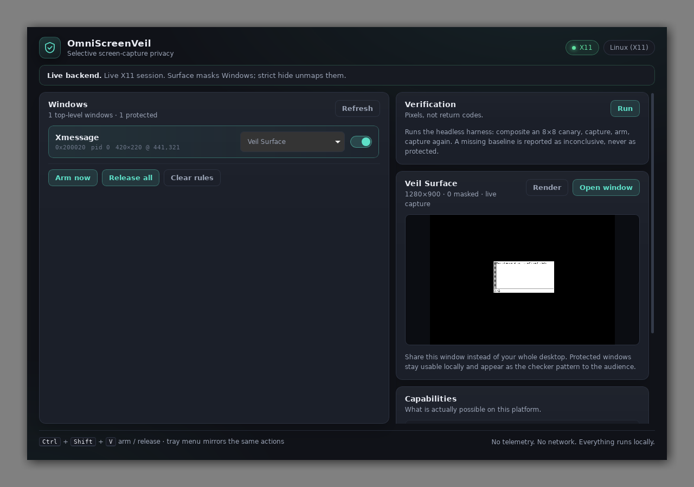
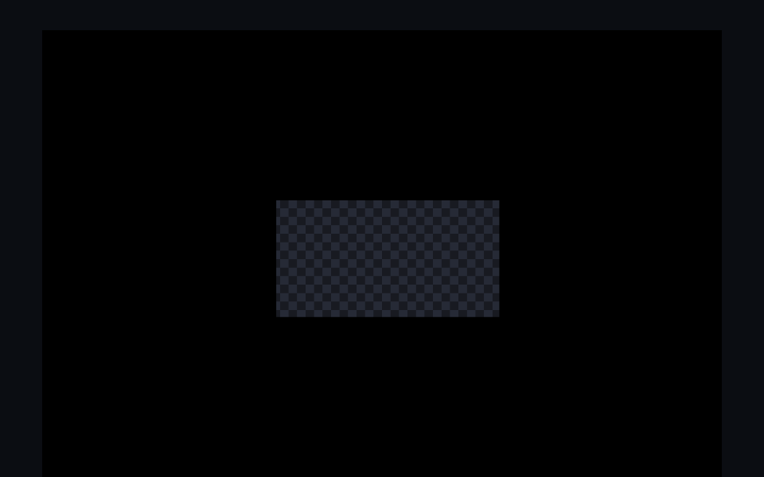

# Verification

The desktop **Capture test** compares live Surface frames with protection off
and on. For Windows Exclusion and other capture paths, verify the receiver's
view in the actual meeting or recording application. Windows and macOS have Rust
cross-target checks and still need native runtime validation.

## The harness

`veil-verify` implements the only ordering that proves anything:

1. Composite an **8×8 canary token** into the region that will be protected.
   Tokens are deterministic per run and colour-coded, so a single matching tile
   is not enough; the detector requires a spatial arrangement.
2. **Capture the baseline** through the target capture path.
3. **Arm** protection (apply exclusion, start the Surface plan, or hide the
   window).
4. **Capture again** and search for the canary.

Outcomes:

| Baseline | After arming | Reported |
|---|---|---|
| canary present | canary absent | `Protected` |
| canary present | canary present | `Visible` |
| canary absent | anything | `Inconclusive` — we could not observe the content, so we cannot claim anything |

The verifier records the capture path, timestamp, OS build and a human-readable
detail string with every run. The UI shows the baseline and post-arm detections
side by side.

## What can be run on a normal machine

### Linux / X11 (validated here)

```sh
cargo test -p veil-protect-linux --test x11_end_to_end
```

`crates/veil-protect-linux/tests/x11_end_to_end.rs` starts its own `Xvfb`
(800×600), draws a canary window, and checks real root and composite captures.

1. The canary is detectable in the raw root capture.
2. The Surface masks both the canary and a reparenting window-manager frame.
3. Strict hide removes the canary from a fresh root capture.
4. A new backend restores the marked window after it is withdrawn from the
   managed inventory. A mismatched PID or a missing marker leaves it alone.

The test reports a skip if `Xvfb` is unavailable.

### Headless core self-test

```sh
cargo run -p veil-cli -- selftest
```

Runs 12 checks over rules, reconciliation, downgrade behaviour, canary
detection, pruning and the simulated baseline→arm→capture flow. No display or
permissions required.

### Desktop app

The native Linux app was launched under Xvfb with Xfwm and a sample window.
The Windows page configured a Surface rule. The separate Surface showed the
sample's title bar and body before arming and masked both afterward while the
original stayed visible. **Capture test** displayed both states. Strict hide
unmapped the window. Both a normal quit and a relaunch after a forced
termination restored the original window. A separate launch with an unreadable
profile kept the original file and withheld Surface frames.

## What must be run on real Windows and macOS

These are deliberately not claimed from a Linux VM.

### Windows

1. Build the app with the MSVC toolchain. `pnpm tauri build` stages
   `veil_hook_win.dll` next to the executable automatically.
2. Start a canary host (any window drawing a known token) and a capture client
   that uses Windows Graphics Capture (OBS "Windows 10" source, or the bundled
   verifier).
3. Arm `Exclusion`, capture, and confirm the canary disappears while the window
   remains visible and interactive.
4. Release and confirm the canary returns.
5. Repeat under a hardware-accelerated app; if the capture path ignores display
   affinity, the verifier must report `Visible`.

### macOS

```sh
cd platform/macos && swift build -c release && swift test
.build/release/veilmac-spike permission
.build/release/veilmac-spike list
.build/release/veilmac-spike capture 1
```

1. Grant Accessibility and Screen Recording.
2. Strict hide a window, run the ScreenCaptureKit capture, confirm the canary is
   absent, then show it again.
3. Confirm `Exclusion` is reported unsupported in the UI and CLI. It must never
   silently "succeed".

### Wayland

The native app and CLI were exercised against a headless sway compositor with
`grim`. The app opened the dashboard and share window without an X server.
Pixel checks covered the sample window body and compositor title bar in the
Surface. A second matching window activated the existing rule through the
live IPC subscription. The CLI also confirmed strict hide and restoration.
Hyprland still needs runtime validation.

```sh
cargo test -p veil-protect-wayland
```

- sway tree → window inventory (absolute geometry, workspace, own-process
  filtering),
- Hyprland client JSON → inventory (address round-trip, workspace, hidden
  state),
- PPM parser used for `grim` frames, including pixel bytes that look like
  whitespace and truncated payloads.

On a real sway or Hyprland session:

```sh
cargo run -p veil-cli -- list
cargo run -p veil-cli -- surface --live --protect <window-id> --out veil.ppm
cargo run -p veil-cli -- protect <window-id> --mode strict-hide
cargo run -p veil-cli -- release <window-id>
```

Confirm the Surface masks protected rectangles and strict hide removes the
window from `grim` output. GNOME/KDE must report partial, not protected.

## Development checks

```sh
cargo test --locked --workspace
cargo test --locked --manifest-path apps/desktop/src-tauri/Cargo.toml
cargo run --locked -p veil-cli -- selftest
pnpm --dir apps/desktop build
```

Visual evidence: the screenshots in `docs/images/` were captured from the
running app under Xvfb + `xcompmgr` with a live X11 backend. They are not
mockups. The preview and the dedicated `OmniScreenVeil Surface` window are
real XComposite window captures composited by `veil-surface`: our own windows
are excluded from the composite, the foreign `xmessage` window is visible when
disarmed, and its rectangle is replaced with the checker veil once armed.







## Reproducing the headless UI check

```sh
# terminal 1
cd apps/desktop && pnpm dev

# terminal 2
Xvfb :77 -screen 0 1280x900x24 -nolisten tcp &
DISPLAY=:77 xmessage -geometry 420x220+440+320 "canary window" &
cd apps/desktop/src-tauri
DISPLAY=:77 dbus-run-session -- env DISPLAY=:77 \
  WEBKIT_DISABLE_COMPOSITING_MODE=1 WEBKIT_DISABLE_DMABUF_RENDERER=1 \
  ./target/debug/omniscreenveil-desktop
# terminal 3
DISPLAY=:77 import -window root docs/images/app-x11.png
```

`WEBKIT_DISABLE_COMPOSITING_MODE` is needed on headless WebKitGTK without a
GPU; it is not required on a normal desktop session.

## Honesty rules for contributors

- Never report `Protected` without a baseline that saw the canary.
- Never add a platform row to the matrix without a capture test.
- If a test cannot run (permission, hardware, OS version), report skip and keep
  the matrix entry honest. Do not turn a skip into a pass.
- Preserve the `Inconclusive` outcome. It is the product's most important
  feature.
